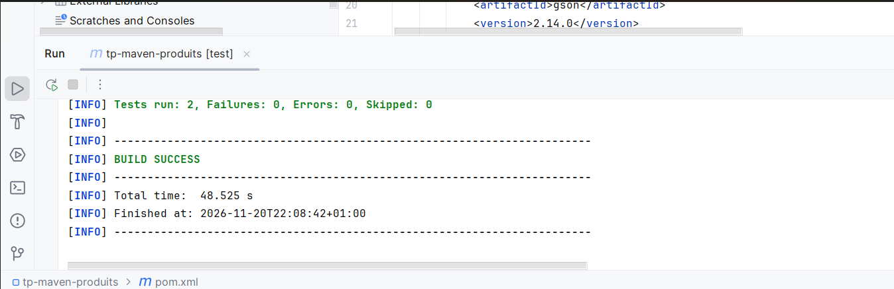

# TP Maven : tp-maven-produits

Projet Maven qui gère un produit (nom, prix en FCFA, quantité en stock), avec Gson et JUnit 5.

## Capture de mvn test

## Étape 3
1. GAV : ga.esiitech.tp : tp-maven-produits : 1.0-SNAPSHOT
2. Le projet est compilé avec Java 25 (maven.compiler.source et maven.compiler.target).
3. La classe Product s'écrit dans src/main/java/ga/esiitech/tp, et son test ProductTest dans src/test/java/ga/esiitech/tp.

## Étape 7
1. Le fichier créé par mvn package est target/tp-maven-produits-1.0-SNAPSHOT.jar. Maven l'a construit avec l'artifactId (tp-maven-produits) et la version (1.0-SNAPSHOT) du pom.xml.
2. Si un test échoue, mvn package affiche BUILD FAILURE et le fichier .jar n'est pas créé.
